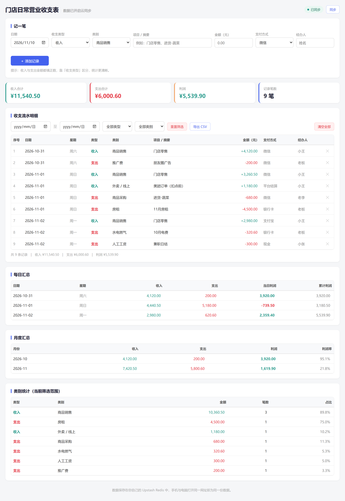
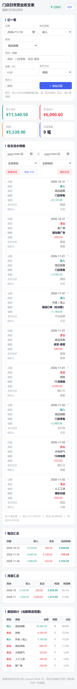

# 门店日常营业收支表（多端同步版）

一个给自己用的门店记账页面：电脑和手机打开同一个网址，看到的是**同一份数据**。

- 前端：单个 `public/index.html`，无框架、无构建
- 接口：`api/data.js`，Vercel Serverless Function
- 存储：Upstash Redis（免费额度足够个人记账）
- 手机上可「添加到主屏幕」，当作 App 用



## 长什么样

一次记录：日期、收支类型、类别、项目 / 摘要、金额、支付方式、经办人。
自动汇总成四块：**流水明细、每日汇总、月度汇总、类别统计**，并且支持日期区间 / 类型 / 类别筛选，筛选结果会同步影响所有汇总和顶部统计卡。

手机上流水明细自动变成一条一张的卡片，不用左右拖动：



## 目录结构

```
store-book/
├── public/
│   └── index.html      ← 记账页面（唯一的前端文件）
├── api/
│   └── data.js         ← Vercel 函数：持有 Upstash Token，读写 Redis
├── scripts/
│   ├── smoke-test.js   ← 无头浏览器冒烟测试（新增 / 删除走完整链路）
│   └── shot.js         ← 截图脚本（可指定手机 / 电脑宽度）
├── dev-server.js       ← 本地预览服务器（含模拟 Redis，不用注册 Upstash）
├── .env.example        ← 本地环境变量示例
├── .gitignore
└── package.json
```

## 一、本地先看效果（不用注册任何账号）

需要 Node 18+。**如果电脑上没装 Node，跳过这一节，直接看第二节——用 GitHub 网页上传也能部署，不需要本地任何命令。**

```bash
npm run dev
```

打开 <http://127.0.0.1:4321>。没有配置 Upstash 时，数据写在 `data/mock-redis.json`（模拟数据库，已被 gitignore）。
此时页面上的数据只是**演示数据**，和以后线上的数据互不影响。

想直接看"两端同步"的效果：浏览器开两个窗口（或一个正常窗口 + 一个隐私窗口）打开同一个地址，在一个窗口记一笔，另一个窗口点右上角「同步」就能看到。

## 二、上线（Vercel + Upstash）

### 1. 建 Upstash 数据库

1. 打开 <https://console.upstash.com/redis>，用 GitHub / Google 账号注册（免费，不用信用卡）。
2. **Create Database**：名字随意（如 `store-book`），区域选离你近的（如 `ap-southeast-1` 新加坡）。
3. 进数据库详情页，找到 **REST API**，复制两个值：
   - `UPSTASH_REDIS_REST_URL`（形如 `https://xxx.upstash.io`）
   - `UPSTASH_REDIS_REST_TOKEN`

> 免费额度：每月 50 万次命令、250 MB 存储、10 GB 带宽。个人记账一天几十次请求，用不完。

### 2. 推到 GitHub

在 GitHub 新建一个空仓库（不要勾选 README）。

**没装 git（推荐，最省事）**：仓库页面点 **Add file → Upload files**，把这个文件夹里的 `public`、`api`、`package.json` 等一起拖进去（可以直接拖文件夹），然后 Commit changes。

**装了 git**：在本目录执行：

```bash
git init
git add .
git commit -m "init store-book"
git branch -M main
git remote add origin https://github.com/你的用户名/store-book.git
git push -u origin main
```

`.env` 已在 `.gitignore` 里，Token 不会被推上去；用网页上传时请**不要**勾选 `data/` 和 `.env`。

### 3. 在 Vercel 导入

1. <https://vercel.com> 用 GitHub 账号登录。
2. **Add New… → Project** → 选中刚推的仓库 → **Import**。
3. 配置页里：

   | 配置项 | 填什么 |
   |---|---|
   | Framework Preset | **Other**（或 Static） |
   | Build Command | 留空 |
   | Output Directory | 留空（默认就会把 `public/` 作为静态目录） |
   | Root Directory | 默认 |

4. 点 **Deploy**，等状态变成 Ready，得到一个 `https://xxx.vercel.app` 网址。

### 4. 配环境变量（关键）

项目页 → **Settings → Environment Variables**，加两条（名字必须一模一样）：

| Name | Value |
|---|---|
| `UPSTASH_REDIS_REST_URL` | Upstash 的 REST URL |
| `UPSTASH_REDIS_REST_TOKEN` | Upstash 的 REST TOKEN |

Environment 勾上 **Production**（Preview / Development 可一并勾上），保存。

### 5. 重新部署让变量生效

**Deployments → 最新一次部署右侧「…」→ Redeploy。**
环境变量不会自动注入到已经构建好的版本，这一步不做，接口会一直报"缺少环境变量"。

### 6. 验证

1. 打开 Vercel 网址，右上角出现绿色的「已同步」。
2. 记一笔，去 Upstash 控制台的 Data Browser 看 `store_records` 这个 Key，能看到刚才的 JSON。
3. 手机浏览器打开**同一个网址**（建议「添加到主屏幕」），能看到这条记录，就说明通了。

## 三、日常使用

- **记账**：填日期 / 类型 / 类别 / 摘要 / 金额，点「添加记录」。日期和类型会保留，方便连续录入。
- **改分类**：编辑 `public/index.html` 顶部的 `CATEGORIES` 对象，增删里面的类别名即可，下拉框自动跟着变。
- **筛选**：选日期区间、类型、类别，下面所有表格和统计卡都会按筛选范围重算。
- **导出**：点「导出 CSV」，用 Excel / WPS 打开，带 BOM，中文不会乱码。
- **删除 / 清空**：流水每行右侧的 ✕；「清空全部」需要二次确认，不可恢复。

### 跨设备同步是怎么做的

- 每条操作（新增 / 删除 / 覆盖）都单独发给 `/api/data`，服务端读 Redis → 改 → 写回 → 返回**完整最新列表**，前端用它覆盖本地并重绘。所以不会出现"手机用旧页面把电脑新记的账覆盖掉"。
- 手机从后台切回前台、网络恢复时，会自动拉一次最新数据。
- 没网也能记：操作先存在浏览器本地队列里，界面立即更新，联网后自动补传（顶栏状态会显示"还有 N 条待上传"）。

### 数据安全

- Upstash 的 Token 只存在于 Vercel 环境变量，浏览器和页面源码里都看不到。
- 但**拿到你这个 Vercel 网址的人就能读写数据**（API 没有登录）。个人自用建议：
  - 网址不要发到公开群 / 公开仓库；
  - 需要更稳妥，可以在 Vercel 给项目开 **Password Protection**（Settings → Deployment Protection），或把项目设为私有预览。
- 定期点「导出 CSV」留一份本地备份，是最省事的保险。

## 四、常见问题

**页面打开是空白 / 404**
确认 `public/index.html` 在仓库里、Vercel 的 Output Directory 没填错。用 F12 → Network 看有没有 404。

**接口 500，提示缺少环境变量**
Settings 里两条变量名拼错，或者加完没点 Redeploy。

**接口 500，提示 Redis GET 失败**
Upstash 的 URL / Token 复制错了（注意别把 `UPSTASH_REDIS_REST_TOKEN` 和数据库密码搞混），或者数据库被删了。

**两端数据对不上**
正常机制是"打开 / 切回前台时拉最新"。一端改完，另一端按一下右上角「同步」即可；不要在两台设备上同时开着页面各改各的。

**能不能多人一起用（店员各记各的）**
可以，但现在是"一个 Key 存全部记录"的模型，人可以多、并发别太高。真要多人协作，建议改用飞书多维表格这类现成工具。

**之前用浏览器本地版记的账怎么办**
第一次部署后打开页面时，如果云端还是空的、而浏览器里存在旧版 `store_income_expense_v1` 的数据，会自动搬上去一次，并提示"已把本机原有 N 条记录搬到云端"。

## 五、开发脚本

```bash
npm run dev                       # 本地服务（模拟 Redis）
node scripts/smoke-test.js        # 无头浏览器点一遍"新增 / 删除"，校验 API 落库
node scripts/shot.js 390 844 out.png   # 按手机宽度截图，并报告横向溢出元素
```

`smoke-test.js` / `shot.js` 需要本机装了 Edge 或 Chrome（用 `EDGE_PATH` 可指定路径），Node 22+。

## 六、关于 vercel.json

本仓库**不需要** `vercel.json`：`public/` 会被当作静态输出目录，`api/` 下的文件会被识别成函数。只有想加自定义响应头（比如给静态资源设长缓存）时才需要新建它。
